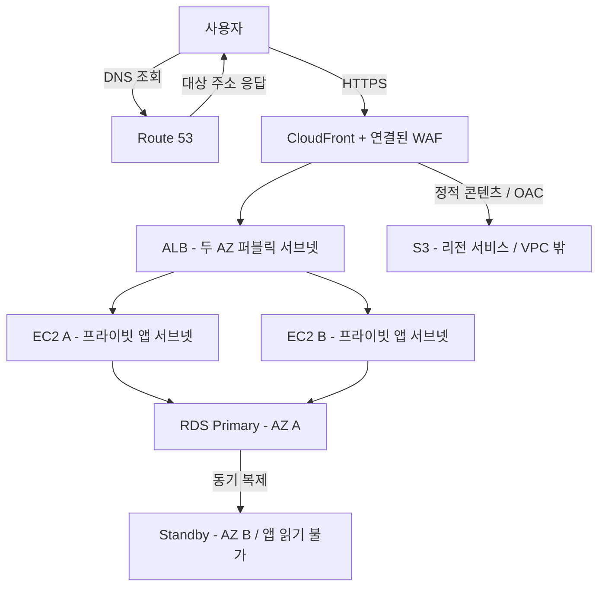
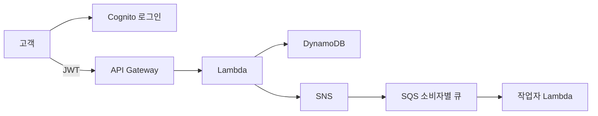
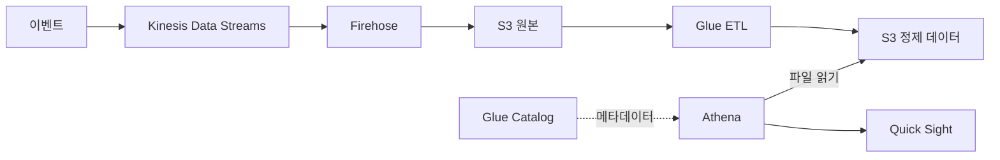
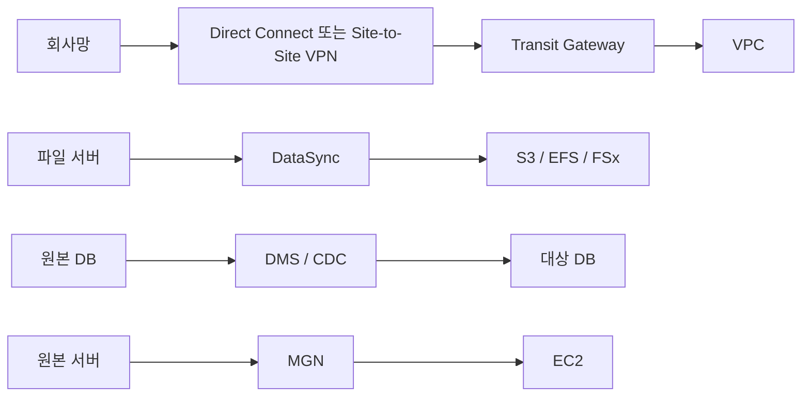
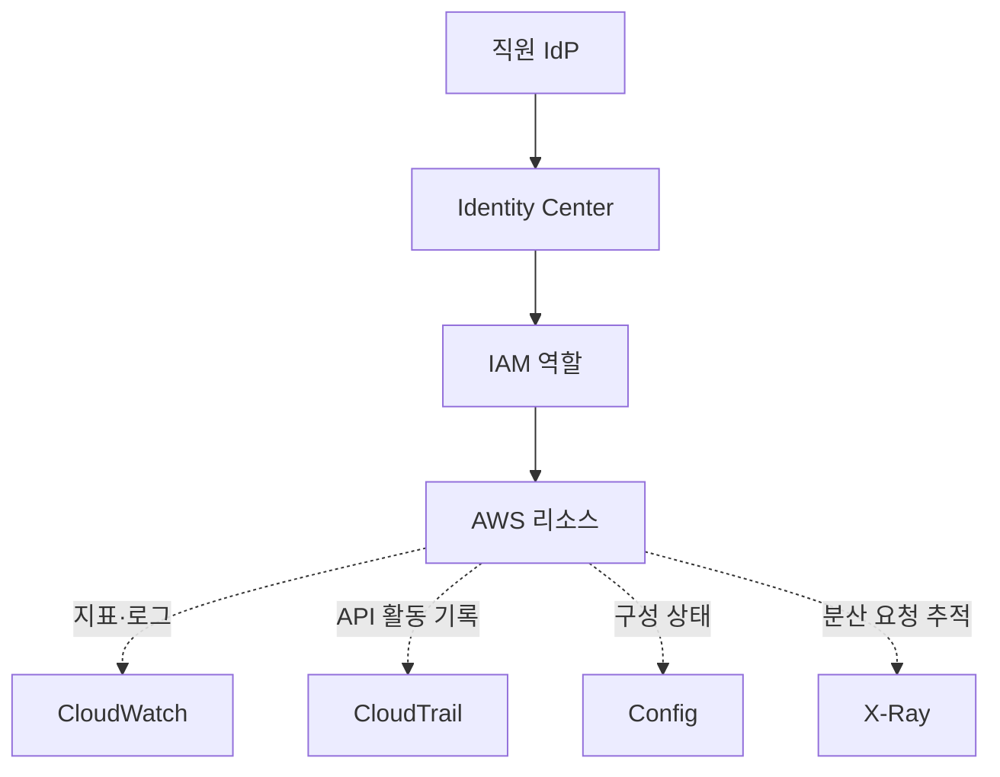
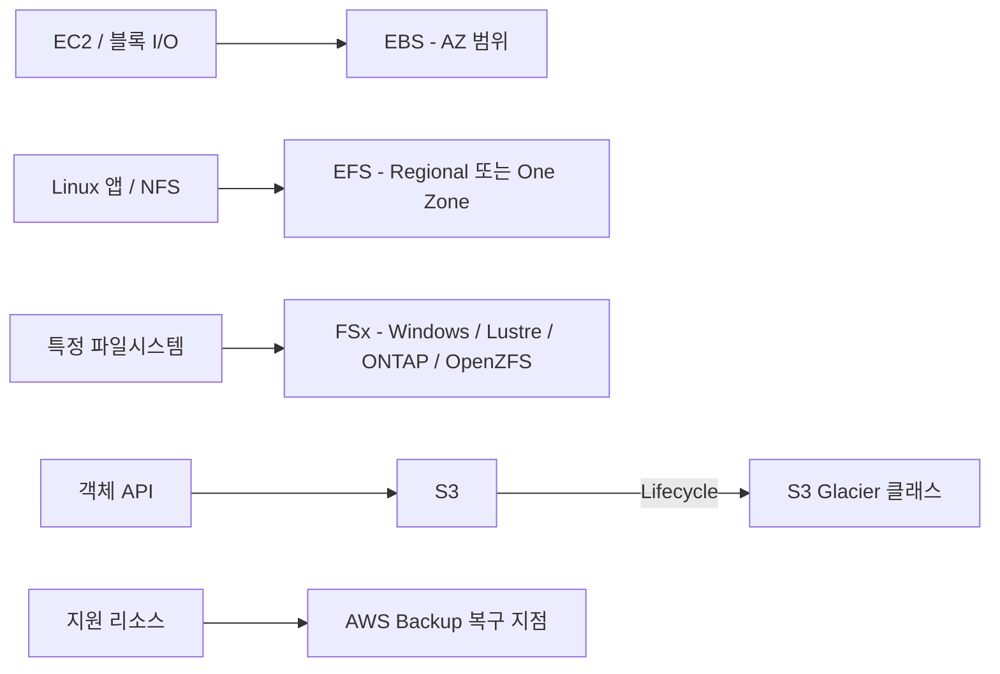

# AWS SAA-C03 서비스 도감

공식 예시 목록 118개(중복 제외), 보충 기능 18개. 확인일 2026-10-18.
공식 목록도 비포괄적이며 변경 가능하므로 실제 출제의 모든 서비스를 보장하는 목록은 아닙니다.

공식 범위: https://docs.aws.amazon.com/aws-certification/latest/solutions-architect-associate-03/saa-03-in-scope-services.html

## 대표 구성 6가지

그림의 화살표는 처리·전달 또는 표시된 제어 관계를 뜻합니다. 네트워크 배치의 세부 조건은 HTML 도감에서 함께 확인하세요.

### 멀티 AZ 웹앱

### 서버리스 요청과 비동기 작업

### 데이터 레이크

### 하이브리드와 이전

### 권한과 관측

### 저장소 선택

## 분석

| 서비스 | 역할 | 배치·연결 위치 | 작동 흐름 | 선택 기준·주의 |
|---|---|---|---|---|
| Amazon Athena | S3 파일을 SQL로 조회 | 리전의 관리형 쿼리 서비스 | S3 데이터 → Athena SQL → 결과 파일 | DB로 옮기지 않는 일회성 분석 |
| AWS Data Exchange | 외부 데이터 구독·교환 | 데이터 제공자와 분석 환경 사이 | 제공자 데이터 → 구독자 분석 | 자체 ETL 엔진과 구분 |
| Amazon Data Firehose | 스트림을 버퍼링해 목적지로 전달 | 수집 계층의 관리형 전달 서비스 | 생성자 → Firehose → S3 등 | Kinesis Data Streams와 역할 구분 |
| Amazon EMR | Spark·Hadoop 대규모 처리 | EC2·EKS·서버리스 실행 환경 | S3 데이터 → 분산 처리 → 결과 | 빅데이터 프레임워크가 단서 |
| AWS Glue | 데이터 카탈로그와 ETL | 데이터 레이크 준비·변환 계층 | 크롤러·카탈로그 → ETL → 정제 데이터 | 카탈로그와 실제 변환 작업을 구분 |
| Amazon Kinesis | 실시간 데이터 스트림 수집·소비 | 생성자와 스트림 소비자 사이 | 생성자 → Data Streams → 여러 소비자 | 재처리·순서·보존 요구를 확인 |
| AWS Lake Formation | 데이터 레이크 권한 통합 | S3·Glue 기반 데이터 접근 관리 | 데이터 등록 → 세밀한 접근 권한 | S3 저장소 자체가 아님 |
| Amazon MSK | 관리형 Apache Kafka | 리전의 Kafka 브로커 환경 | Kafka 생산자 → 토픽 → 소비자 | 기존 Kafka 호환성이 단서 |
| Amazon OpenSearch Service | 검색·로그 분석 인덱스 | 검색·분석 계층 | 로그·문서 → 인덱싱 → 검색 | 트랜잭션 원장 DB와 구분 |
| Amazon Quick | 분석 결과를 대시보드로 시각화 | 데이터 소비·BI 계층 | Athena·Redshift 등 → Quick Sight | 옛 QuickSight 명칭도 함께 기억 |

> Amazon Quick: 명칭 변경: 예전 QuickSight는 현재 Quick의 Quick Sight 기능으로 이어집니다. 이 도감은 시험의 BI 용도에 초점을 맞춥니다.

| Amazon Redshift | 분석용 데이터 웨어하우스 | 리전의 분석 DB 계층 | 적재·외부 데이터 → 집계 SQL | 주문 처리 OLTP와 구분 |

## 애플리케이션 통합

| 서비스 | 역할 | 배치·연결 위치 | 작동 흐름 | 선택 기준·주의 |
|---|---|---|---|---|
| Amazon AppFlow | SaaS와 AWS 간 데이터 전달 | SaaS 데이터 연동 계층 | 업무 SaaS → 흐름 → AWS 저장소 | SQS 메시지 큐와 구분 |
| Amazon EventBridge | 이벤트를 조건에 따라 분배 | 이벤트 버스·라우팅 계층 | 이벤트 → 규칙 → 대상 서비스 | 콘텐츠 기반 라우팅이 단서 |
| Amazon MQ | ActiveMQ·RabbitMQ 브로커 운영 | 기존 메시징 앱 사이 | 기존 프로토콜 → 브로커 → 앱 | 기존 JMS·AMQP 호환성 |
| Amazon SNS | 하나의 알림을 여러 구독자에게 전달 | 게시·구독 계층 | 발행자 → 토픽 → 여러 큐·함수 | 팬아웃, 각 소비자 독립 큐 |
| Amazon SQS | 작업을 쌓아 비동기 처리 | 생산자와 작업자 사이 | 앱 → 큐 → 작업자 → 삭제 | Standard 중복 수신 대비 멱등성 |
| AWS Step Functions | 여러 작업의 순서·분기·재시도 조정 | 워크플로 제어 계층 | 상태 머신 → 함수·컨테이너 작업 | 단순 알림과 장기 워크플로 구분 |

## 비용 관리

| 서비스 | 역할 | 배치·연결 위치 | 작동 흐름 | 선택 기준·주의 |
|---|---|---|---|---|
| AWS Budgets | 예산·사용량 임계치 알림 | 계정·조직의 비용 관리 | 비용 집계 → 예산 비교 → 알림 | 기본적으로 모든 지출을 자동 차단하지 않음 |
| AWS Cost and Usage Report | 세부 비용·사용량 원시 내역 | 청구 데이터 분석 계층 | 사용량 → 보고서 → S3·분석 | 상세 청구 데이터가 필요할 때 |
| AWS Cost Explorer | 비용 추세·분포 탐색 | 청구 분석 화면·API | 비용 데이터 → 필터·그래프 | 예산 알림과 구분 |
| Savings Plans | 시간당 사용 금액 약정으로 할인 | 지원 컴퓨팅 사용량의 과금 | 사용 약정 → 적격 사용량 할인 | 용량 예약과 할인 약정을 구분 |

## 컴퓨팅

| 서비스 | 역할 | 배치·연결 위치 | 작동 흐름 | 선택 기준·주의 |
|---|---|---|---|---|
| AWS Batch | 배치 작업 큐·실행 자원 관리 | 배치 컴퓨팅 계층 | 작업 제출 → 큐 → 실행 환경 | 대량의 독립 작업 처리 |
| Amazon EC2 | 운영체제를 제어하는 가상 서버 | 선택한 AZ의 서브넷 | 요청 → 앱 프로세스 → DB·스토리지 | OS 관리·용량·구매 옵션 판단 |
| Amazon EC2 Auto Scaling | EC2 수량 유지·증감 | 하나 이상의 AZ에 걸친 그룹 | 지표·상태 → 인스턴스 교체·증감 | 로드 밸런서와 역할 구분 |
| AWS Elastic Beanstalk | 코드 중심으로 웹앱 환경 배포 | EC2·로드 밸런서 등을 관리 | 코드 업로드 → 환경 생성·배포 | 기반 리소스 비용·설정은 남음 |
| AWS Outposts | AWS 인프라를 온프레미스에 확장 | 고객 데이터센터·엣지 | 로컬 워크로드 ↔ AWS 리전 | 현장 처리·데이터 위치 요구 |
| AWS Serverless Application Repository | 재사용 가능한 서버리스 앱 배포 | 서버리스 배포 카탈로그 | 템플릿 선택 → 앱 리소스 배포 | 실행 환경 자체와 구분 |
| VMware Cloud on AWS | VMware 환경을 AWS로 확장 | AWS 기반 VMware SDDC | 온프레미스 VMware ↔ 클라우드 환경 | 기존 VMware 운영 모델 |

> VMware Cloud on AWS: 기존 VMware 기반 하이브리드 구성 개념입니다. 실제 도입 시 현재 판매·지원 경로와 계약 조건을 별도 확인하세요.

| AWS Wavelength | 통신망 엣지 가까이 워크로드 배치 | 통신 사업자 엣지 인프라 | 모바일 단말 → 통신망 엣지 앱 | 초저지연 모바일 서비스 |

## 컨테이너

| 서비스 | 역할 | 배치·연결 위치 | 작동 흐름 | 선택 기준·주의 |
|---|---|---|---|---|
| Amazon ECR | 컨테이너 이미지 저장소 | 배포 전 이미지 보관 계층 | 빌드 → 이미지 푸시 → 실행 시 풀 | 컨테이너를 실행하는 서비스가 아님 |
| Amazon ECS | 컨테이너 작업·서비스 조정 | EC2 또는 Fargate 실행 계층 | 이미지 → 태스크 → 서비스 | ECS는 조정, Fargate는 실행 자원 |
| Amazon ECS Anywhere | 외부 서버를 ECS로 관리 | 온프레미스·외부 인프라 | 외부 호스트 등록 → 태스크 실행 | 서버 자체 운영 책임은 남음 |
| Amazon EKS | 관리형 Kubernetes 제어 영역 | 리전의 Kubernetes 환경 | 매니페스트 → 파드 → 워커 | Kubernetes 요구가 명시될 때 |
| Amazon EKS Anywhere | 자체 인프라에서 Kubernetes 운영 | 온프레미스·고객 인프라 | 클러스터 생성 → 파드 배포 | 클라우드 EKS와 운영 범위 차이 |
| Amazon EKS Distro | EKS와 같은 기반의 Kubernetes 배포판 | 직접 구성하는 실행 환경 | 배포판 → 자체 클러스터 운영 | 관리형 EKS 서비스가 아님 |

## 데이터베이스

| 서비스 | 역할 | 배치·연결 위치 | 작동 흐름 | 선택 기준·주의 |
|---|---|---|---|---|
| Amazon Redshift | 분석용 데이터 웨어하우스 | 리전의 분석 DB 계층 | 적재·외부 데이터 → 집계 SQL | 주문 처리 OLTP와 구분 |
| Amazon Aurora | MySQL·PostgreSQL 호환 관계형 DB | 리전의 클러스터·VPC 연결 | 앱 → Writer·Reader endpoint → 공유 스토리지 | 저장 복제와 읽기 인스턴스 수는 별개 |
| Amazon Aurora Serverless | DB 컴퓨팅 용량 자동 조절 | Aurora 클러스터의 컴퓨팅 계층 | 부하 변화 → 용량 조절 → SQL 처리 | 지원 버전·용량·연결 조건 확인 |
| Amazon DocumentDB | MongoDB 호환 문서 DB | 리전의 관리형 DB 클러스터 | JSON형 문서 → 쿼리·인덱스 | MongoDB 기능 완전 동일로 단정 금지 |
| Amazon DynamoDB | 키-값·문서형 NoSQL | 리전의 관리형 서비스, VPC 밖 | 앱 API → 키·인덱스 → 항목 | 관계형 조인보다 접근 패턴 설계 |
| Amazon ElastiCache | 인메모리 캐시 | 앱과 DB 사이의 캐시 계층 | 캐시 조회 → 미스 때 DB → 캐시 저장 | 주문 원장 DB 대체로 단정 금지 |
| Amazon Keyspaces | Apache Cassandra 호환 DB | 리전의 관리형 서비스 | CQL 클라이언트 → 테이블 | Cassandra 호환성이 단서 |
| Amazon Neptune | 관계 탐색용 그래프 DB | 리전의 그래프 DB 계층 | 정점·간선 → 관계 탐색 쿼리 | 추천·부정 탐지의 관계 중심 데이터 |
| Amazon RDS | 여러 엔진의 관리형 관계형 DB | DB 서브넷 그룹의 AZ들 | 앱 → DB endpoint → SQL | 일반 Multi-AZ 인스턴스 standby는 읽기용 아님 |

## 개발 도구

| 서비스 | 역할 | 배치·연결 위치 | 작동 흐름 | 선택 기준·주의 |
|---|---|---|---|---|
| AWS X-Ray | 분산 요청의 지연·오류 추적 | 서비스 호출 관측 계층 | 호출 구간 → 트레이스 → 병목 분석 | CloudTrail API 감사와 구분 |

## 웹·모바일

| 서비스 | 역할 | 배치·연결 위치 | 작동 흐름 | 선택 기준·주의 |
|---|---|---|---|---|
| AWS Amplify | 프런트엔드 호스팅·앱 백엔드 연동 | 웹·모바일 앱 개발·배포 계층 | 코드 → 빌드·호스팅 → 사용자 | 범용 가상 서버와 구분 |
| Amazon API Gateway | API 엔드포인트·인증·제한 관리 | 클라이언트와 백엔드 사이 | HTTP 요청 → 인증·라우팅 → Lambda 등 | HTTP API와 REST API 기능 차이 |
| AWS Device Farm | 실제 기기·브라우저 앱 테스트 | 배포 전 품질 확인 계층 | 앱·테스트 → 기기 실행 → 결과 | 운영 트래픽 로드 밸런서가 아님 |

## AI·머신러닝

| 서비스 | 역할 | 배치·연결 위치 | 작동 흐름 | 선택 기준·주의 |
|---|---|---|---|---|
| Amazon Comprehend | 텍스트의 감정·개체 등 분석 | 앱이 호출하는 AI 서비스 | 텍스트 → 언어 분석 결과 | 이미지 OCR과 구분 |
| Amazon Lex | 대화형 음성·텍스트 봇 | 사용자와 업무 시스템 사이 | 발화 → 의도·슬롯 → 업무 처리 | 단순 음성 받아쓰기와 구분 |
| Amazon Polly | 텍스트를 음성으로 변환 | 음성 출력 생성 계층 | 텍스트 → 합성 음성 | Transcribe의 반대 방향 |
| Amazon Rekognition | 이미지·영상 내용 분석 | 미디어 분석 계층 | 이미지·영상 → 객체·콘텐츠 분석 | 문서 표·양식 추출은 Textract |
| Amazon SageMaker AI | ML 모델 개발·훈련·배포 | 머신러닝 작업 환경 | 데이터 → 훈련 → 모델 → 추론 | 완성형 AI API와 직접 모델 개발 구분 |
| Amazon Textract | 문서 글자·표·양식 추출 | 문서 데이터 추출 계층 | 문서 이미지 → 텍스트·구조 | 단순 감정 분석과 구분 |
| Amazon Transcribe | 음성을 텍스트로 변환 | 음성 입력 처리 계층 | 음성 → 받아쓰기 텍스트 | Polly와 방향 구분 |
| Amazon Translate | 언어 간 텍스트 번역 | 앱의 번역 처리 계층 | 원문 텍스트 → 번역문 | 음성 인식 기능 자체가 아님 |

## 운영·거버넌스

| 서비스 | 역할 | 배치·연결 위치 | 작동 흐름 | 선택 기준·주의 |
|---|---|---|---|---|
| AWS Auto Scaling | 지원 리소스의 확장 정책 관리 | 여러 서비스의 용량 관리 | 부하 목표 → 지원 리소스 확장 | EC2 Auto Scaling과 범위 구분 |
| AWS CLI | 명령줄에서 AWS API 실행 | 운영자 PC·자동화 환경 | 명령 → 서명된 API 호출 | 권한은 IAM으로 평가 |
| AWS CloudFormation | 템플릿으로 인프라 배포 | 리소스 생성·변경 제어 계층 | 템플릿 → 스택 → AWS 리소스 | 여러 계정·리전 배포는 StackSets |
| AWS CloudTrail | AWS API 활동 감사 | 계정·리전의 감사 기록 계층 | API 호출 → 이벤트 → Trail·로그 | S3 객체 작업은 데이터 이벤트 설정 확인 |
| Amazon CloudWatch | 지표·로그·경보 관측 | 시스템 운영 모니터링 계층 | 지표·로그 → 경보 → 대응 | 사용자 API 이력은 CloudTrail |
| AWS Compute Optimizer | 지표 기반 자원 크기 추천 | 운영 지표 분석 계층 | 사용률 → 적정 용량 추천 | 추천을 자동 적용한다고 단정 금지 |
| AWS Config | 리소스 구성 이력·규칙 준수 평가 | 설정 상태 기록·평가 계층 | 구성 변경 → 기록 → 규칙 평가 | 누가 호출했는가는 CloudTrail |
| AWS Control Tower | 멀티 계정 랜딩존 구축·관리 | Organizations 위의 거버넌스 계층 | 계정 생성 → 통제·기준 적용 | 조직 구조 자체와 상위 운영 기능 구분 |
| AWS Health Dashboard | AWS 장애·계정 영향 안내 | 서비스 상태·계정 이벤트 화면 | AWS 이벤트 → 계정 영향 확인 | 내 앱의 CPU 지표는 CloudWatch |
| AWS License Manager | 소프트웨어 라이선스 사용 관리 | 계정·인프라의 라이선스 관리 | 라이선스 규칙 → 사용량 추적 | 컴퓨팅 자동 확장 서비스가 아님 |
| Amazon Managed Grafana | 여러 관측 데이터 대시보드 | 운영 시각화 계층 | 지표 소스 → Grafana 화면 | Prometheus 지표 수집·저장과 구분 |
| Amazon Managed Service for Prometheus | Prometheus 지표 수집·저장·질의 | 컨테이너 관측 계층 | 메트릭 → 관리형 저장소 → PromQL | 대시보드 자체는 Grafana 등 |
| AWS Management Console | 브라우저에서 AWS 관리 | 운영자 웹 관리 화면 | 로그인 → 화면 조작 → 서비스 API | 별도 컴퓨팅 실행 서비스가 아님 |
| AWS Organizations | 멀티 계정·OU·정책 관리 | 계정들 위의 조직 관리 계층 | 조직·OU → 계정 → 정책 통제 | SCP는 권한 상한이며 Allow 부여 아님 |
| AWS Service Catalog | 승인된 제품 템플릿 배포 | 기업의 셀프서비스 배포 계층 | 승인 포트폴리오 → 사용자가 배포 | 아무 리소스나 무제한 허용하는 기능 아님 |
| AWS Systems Manager | 서버 관리·패치·명령·파라미터 | EC2·외부 관리 노드 운영 계층 | 관리자 → 세션·명령·패치 → 노드 | Session Manager는 SSH 포트 개방을 줄임 |
| AWS Trusted Advisor | 비용·보안·한도 등 모범 사례 점검 | 계정 상태 조언 계층 | 환경 검사 → 개선 권고 | 모든 항목이 자동 수정되는 것은 아님 |
| AWS Well-Architected Tool | 아키텍처를 원칙에 따라 검토 | 설계 검토·개선 관리 계층 | 워크로드 질문 → 위험·개선 계획 | 런타임 방화벽이 아님 |

## 미디어

| 서비스 | 역할 | 배치·연결 위치 | 작동 흐름 | 선택 기준·주의 |
|---|---|---|---|---|
| Amazon Elastic Transcoder | 동영상 포맷 변환의 과거 서비스 | 과거 S3 기반 미디어 파이프라인 | 원본 영상 → 변환 작업 → 출력 | 종료 서비스: 현재 구성은 MediaConvert 등 확인 |

> Amazon Elastic Transcoder: 지원 종료: Elastic Transcoder는 2025-11-13 이후 콘솔과 리소스 접근이 종료됩니다. 공식 시험 예시 목록에 남아 있어 과거 개념을 함께 설명합니다.

| Amazon Kinesis Video Streams | 영상 스트림 수집·저장·소비 | 카메라·미디어 수집 계층 | 카메라 → 영상 스트림 → 소비자 | 일반 이벤트용 Data Streams와 구분 |

## 마이그레이션·전송

| 서비스 | 역할 | 배치·연결 위치 | 작동 흐름 | 선택 기준·주의 |
|---|---|---|---|---|
| AWS Application Migration Service | 서버를 AWS로 재호스팅 | 원본 서버와 EC2 이전 계층 | 서버 복제 → 테스트 → 컷오버 | DB 테이블 복제 전용은 DMS |
| AWS DataSync | 파일·객체 데이터 온라인 이동 | 원본 스토리지와 AWS 저장소 사이 | 원본 → 전송 작업 → S3·EFS·FSx | 지속적인 파일 접근 인터페이스는 Gateway |
| AWS DMS | DB 데이터 이전·변경 복제 | 원본 DB와 대상 DB 사이 | 초기 데이터 → CDC → 대상 DB | 스키마·코드 변환 범위는 별도 확인 |
| AWS Snow Family | 물리 장치 기반 데이터 이동·엣지 | 과거 또는 기존 고객의 오프라인 경로 | 장치에 적재 → 운송 → AWS 반입 | 현재 신규 고객 장치 주문 불가 |

> AWS Snow Family: 신규 사용 제한: 현재 신규 고객은 Snow Family 장치를 주문할 수 없습니다. 과거 문제의 오프라인 이전 개념과 현재 구축 선택을 구분하세요.

| AWS Transfer Family | 관리형 SFTP·FTPS·FTP 등 전송 | 외부 파일 클라이언트 접속 계층 | 파일 전송 프로토콜 → S3·EFS | DataSync의 데이터 복사 작업과 구분 |

## 네트워크·콘텐츠 전송

| 서비스 | 역할 | 배치·연결 위치 | 작동 흐름 | 선택 기준·주의 |
|---|---|---|---|---|
| AWS Client VPN | 개별 사용자의 원격 VPN | 사용자 기기와 VPC 사이 | 원격 PC → VPN → 사설 리소스 | 네트워크 간 연결은 Site-to-Site VPN |
| Amazon CloudFront | 엣지에서 콘텐츠 캐시·전달 | 사용자 가까운 글로벌 엣지 | 사용자 → 캐시 조회 → 필요할 때 원본 | S3 비공개 원본은 OAC 고려 |
| AWS Direct Connect | 온프레미스와 AWS의 전용 연결 | 사업장·연결 지점과 AWS 사이 | 회사망 → 전용 회선 → AWS | 전용 연결 자체가 자동 암호화는 아님 |
| Elastic Load Balancing | 정상 대상에 트래픽 분산 | 여러 AZ에 연결된 로드 밸런서 | 요청 → 리스너·규칙 → 정상 대상 | HTTP 경로 분기 ALB, L4 요구 NLB |
| AWS Global Accelerator | 애니캐스트 IP로 전역 트래픽 전달 | AWS 글로벌 네트워크 입구 | 가까운 엣지 → AWS 망 → 리전 endpoint | CloudFront처럼 객체 캐시하지 않음 |
| AWS PrivateLink | 서비스에 사설 엔드포인트로 접속 | 소비자 VPC ENI와 제공 서비스 사이 | 클라이언트 → 인터페이스 endpoint → 서비스 | VPC 전체를 상호 연결하는 피어링과 구분 |
| Amazon Route 53 | DNS·상태 확인·라우팅 정책 | 글로벌 DNS, Resolver는 VPC 연동 | 도메인 조회 → 대상 주소 응답 | 일반 HTTP 요청이 DNS를 통과하는 것은 아님 |
| AWS Site-to-Site VPN | 회사망과 AWS의 암호화 VPN | 고객 게이트웨이와 AWS 사이 | 회사 라우터 → IPsec → VPC·TGW | 인터넷 기반 연결, DX와 구분 |
| AWS Transit Gateway | 여러 VPC·회사망 연결 허브 | 리전의 네트워크 연결 허브 | 연결된 망 → TGW 경로 → 다른 망 | 연결됐다고 모든 경로가 자동 허용되진 않음 |
| Amazon VPC | 리전 내 논리적으로 격리된 네트워크 | 리전 안에 AZ별 서브넷 포함 | 경로·서브넷·보안 정책 → 통신 | S3·DynamoDB를 서브넷 안 서버로 그리지 않기 |

## 보안·신원·규정

| 서비스 | 역할 | 배치·연결 위치 | 작동 흐름 | 선택 기준·주의 |
|---|---|---|---|---|
| AWS Artifact | 감사·규정 준수 문서 제공 | 고객이 확인하는 규정 자료 포털 | 문서 선택 → 보고서 확인 | 내 환경의 규정 준수 자동 평가가 아님 |
| AWS Certificate Manager | TLS 인증서 발급·관리 | CloudFront·ALB 등 TLS 종료점 | 인증서 발급 → 대상 서비스 연결 | 데이터 저장 암호화 키는 KMS |
| AWS CloudHSM | 전용 HSM 클러스터 | 고객이 제어하는 암호화 장비 계층 | 앱 → HSM 암호 연산 | 세밀한 장비 제어·관리 책임 |
| Amazon Cognito | 앱 고객 로그인·신원 연동 | 사용자 앱의 인증 계층 | 고객 로그인 → 토큰 → API 접근 | 직원 AWS 계정 SSO는 Identity Center |
| Amazon Detective | 보안 사건의 관계·원인 조사 | 보안 분석·수사 계층 | 관측 데이터 → 관계 분석 → 조사 | 예방 방화벽이나 최초 탐지와 구분 |
| AWS Directory Service | Active Directory 연동·관리 | AD 기반 인증·도메인 계층 | 회사 AD·관리형 AD → 서비스 인증 | 앱 고객용 소셜 로그인과 구분 |
| AWS Firewall Manager | 여러 계정의 방화벽 정책 관리 | 조직 보안 정책 제어 계층 | 중앙 정책 → 계정·리소스 적용 | 패킷을 직접 처리하는 방화벽과 구분 |
| Amazon GuardDuty | 로그·신호 기반 위협 탐지 | 관리형 보안 탐지 계층 | 활동 신호 → 이상 징후 → finding | 취약점 스캐너 Inspector와 구분 |
| AWS IAM Identity Center | 직원의 AWS 계정·앱 SSO | 직원 IdP와 여러 AWS 계정 사이 | 직원 로그인 → 권한 집합 → 역할 | Cognito 고객 인증과 구분 |
| Amazon Inspector | 지원 워크로드의 취약점 검사 | EC2·이미지·Lambda 등 검사 계층 | 워크로드 정보 → 취약점 finding | 의심스러운 계정 활동은 GuardDuty |
| AWS KMS | 암호화 키 생성·권한·사용 관리 | 서비스의 키 관리 계층 | 서비스 → KMS 키 권한·암호 연산 | S3 객체 전체가 항상 KMS를 경유하진 않음 |
| Amazon Macie | S3 민감정보 탐색 | S3 데이터 보안 분석 계층 | S3 객체 분석 → 민감정보 finding | S3 내용을 자동 익명화하는 기능은 아님 |
| AWS Network Firewall | VPC 네트워크 트래픽 검사 | AZ별 방화벽 endpoint 경로 | 라우팅된 트래픽 → 검사 → 전달 | WAF의 HTTP 계층 검사와 구분 |
| AWS RAM | 지원 리소스를 계정 간 공유 | 멀티 계정 리소스 공유 계층 | 소유자 공유 → 참여 계정 사용 | 일반적인 모든 데이터 복사 기능이 아님 |
| AWS Secrets Manager | 자격 증명 저장·조회·교체 | 앱과 DB·외부 서비스 사이 | 앱 역할 → 비밀 조회 → DB 접속 | 앱이 새 비밀을 읽어야 변경이 반영됨 |
| AWS Security Hub | 보안 결과·상태 통합 | 여러 보안 서비스의 집계 계층 | 서비스 finding → 통합·우선순위 | 모든 finding을 자체 센서로 탐지하는 것은 아님 |
| AWS Shield | DDoS 보호 | AWS 지원 리소스의 공격 완화 계층 | 공격 트래픽 → 탐지·완화 | HTTP 요청 조건 필터는 WAF |
| AWS WAF | HTTP 요청 조건 검사·차단 | CloudFront·ALB 등 지원 리소스에 연결 | 웹 요청 → 웹 ACL 규칙 → 허용·차단 | 독립 서버나 VPC 전체 패킷 방화벽 아님 |
| IAM | AWS API 권한과 신뢰 관계 관리 | 서비스 전반의 권한 제어 계층 | 주체·정책·요청 → 허용·거부 판단 | 명시적 Deny 우선, 역할은 임시 자격 증명 |

## 서버리스

| 서비스 | 역할 | 배치·연결 위치 | 작동 흐름 | 선택 기준·주의 |
|---|---|---|---|---|
| AWS Fargate | 서버 관리 없이 컨테이너 실행 | ECS·EKS가 사용하는 컴퓨팅 계층 | 태스크·파드 → 실행 자원 → 컨테이너 | ECS·EKS를 대체하는 조정기가 아님 |
| AWS Lambda | 이벤트로 함수를 실행 | 리전의 관리형 함수 실행 환경 | API·큐·이벤트 → 함수 → 결과 | VPC 연결 시 네트워크 경로를 별도 설계 |

## 스토리지

| 서비스 | 역할 | 배치·연결 위치 | 작동 흐름 | 선택 기준·주의 |
|---|---|---|---|---|
| AWS Backup | 지원 리소스 백업 정책·복원 관리 | 백업 계획·Vault 계층 | 태그·일정 → 복구 지점 → 복원 | 고가용성과 과거 시점 복구는 다른 목적 |
| Amazon EBS | EC2용 블록 볼륨 | 볼륨이 속한 단일 AZ | EC2 → 블록 읽기·쓰기 → 볼륨 | 공유 파일시스템처럼 취급하지 않기 |
| Amazon EFS | Linux용 공유 NFS 파일시스템 | Regional은 여러 AZ, One Zone도 존재 | 여러 컴퓨팅 → mount target → 공유 파일 | Regional과 One Zone 내구성 경계 구분 |
| Amazon FSx | 특정 파일시스템의 관리형 제공 | 엔진·배포 유형별 VPC 파일 환경 | 클라이언트 → SMB·NFS·Lustre 등 | Windows·Lustre·ONTAP·OpenZFS 구분 |
| Amazon S3 | 객체 단위 저장소 | 리전의 관리형 서비스, 일반적으로 VPC 밖 | 객체 PUT·GET → 버킷 | 파일 디스크·POSIX 볼륨과 다름 |
| Amazon S3 Glacier | 장기 보관용 S3 스토리지 클래스 | S3 객체의 보관 계층 | 수명 주기 전환 → 보관 → 필요 시 복원 | Instant·Flexible·Deep Archive 복원 차이 |
| AWS Storage Gateway | 온프레미스에 클라우드 저장 인터페이스 | 회사망과 AWS 스토리지 경계 | 파일·볼륨·테이프 인터페이스 → AWS | 일회성 복사는 DataSync와 비교 |

## 보충 기능 18개

| 기능 | 역할 | 위치 | 흐름 | 주의 |
|---|---|---|---|---|
| Security Group | 상태를 추적하는 네트워크 허용 규칙 | EC2·DB 등의 네트워크 인터페이스 | 접속 요청 → 허용 규칙 → 응답 추적 | 명시적 거부 규칙은 NACL과 구분 |
| Network ACL | 서브넷 경계의 상태 비저장 필터 | 서브넷 단위 | 패킷 → 순서 있는 허용·거부 규칙 | 반환 트래픽 규칙도 고려 |
| Internet Gateway | VPC와 인터넷 연결 | VPC에 연결하는 게이트웨이 | 퍼블릭 서브넷 경로 → IGW → 인터넷 | 연결만으로 모든 인스턴스가 공개되진 않음 |
| NAT Gateway | 프라이빗 자원의 IPv4 외부 통신 | 배포 형태에 맞춘 VPC 경로 | 사설 앱 → NAT → 외부 서비스 | 외부에서 시작한 임의 연결을 받는 용도 아님 |
| VPC Endpoint | AWS 서비스에 사설 경로 제공 | Gateway 또는 Interface endpoint | VPC 앱 → endpoint → AWS 서비스 | S3·DynamoDB Gateway와 PrivateLink 구분 |
| VPC Peering | 두 VPC의 사설 네트워크 연결 | 두 VPC 사이 | VPC A → 피어링 → VPC B | 전이 라우팅 불가, CIDR 겹침 확인 |
| Route Table | 목적지에 따라 다음 홉 선택 | 서브넷에 연결한 라우팅 정책 | 목적지 IP → 최장 접두사 경로 | 보안 그룹이 라우팅을 대신하지 않음 |
| AWS STS | 임시 AWS 자격 증명 발급 | IAM 역할 수임·연동 계층 | 역할 수임 → 임시 자격 증명 → API | 장기 키를 앱에 박아 넣는 방식과 구분 |
| DynamoDB Accelerator (DAX) | DynamoDB 읽기 캐시 | VPC의 캐시 클러스터 | 앱 → DAX → 캐시 미스 때 DynamoDB | 강력 일관 읽기는 캐시가 아닌 DB로 전달 |
| Amazon RDS Proxy | DB 연결 풀·접속 중개 | 앱과 RDS·Aurora 사이 | 여러 앱 연결 → 풀 → DB 연결 | 읽기 복제본처럼 쿼리 연산 용량을 늘리진 않음 |
| CloudFront OAC | CloudFront의 S3 원본 접근 제어 | 배포와 비공개 S3 원본 사이 | CloudFront 서명 요청 → S3 정책 확인 | S3 웹사이트 endpoint와 일반 버킷 원본 구분 |
| S3 Lifecycle | 객체 보관 계층·만료 자동 관리 | S3 버킷 정책 설정 계층 | 객체 경과 시간 → 전환·만료 | 클래스별 최소 보관·복원 요구 확인 |
| FSx for Windows File Server | Windows 공유 파일 | SMB·Active Directory 환경 | Windows 앱 → SMB 공유 | Linux NFS와 구분 |
| FSx for Lustre | HPC용 병렬 공유 파일 | 고성능 Linux·분석 환경 | 작업자 → 병렬 파일, S3 연동 선택 | Windows SMB 공유와 구분 |
| FSx for NetApp ONTAP | ONTAP 기능의 관리형 파일 | NFS·SMB·iSCSI 요구 환경 | 클라이언트 → ONTAP 파일시스템 | 기존 NetApp 기능·프로토콜 요구 |
| FSx for OpenZFS | ZFS 기반 관리형 NFS | Linux·Unix NFS 환경 | 앱 → NFS → OpenZFS | ZFS 스냅샷·복제 사용 사례 |
| RDS Multi-AZ DB instance | 장애 시 다른 AZ로 전환 | Primary·Standby가 서로 다른 AZ | Primary → 동기 복제 → Standby | 이 유형의 standby는 읽기 트래픽 처리 불가 |
| RDS Read Replica | 읽기 부하를 분산하는 복제본 | 지원 엔진·리전 조건에 따른 복제 | Primary → 비동기 복제 → 읽기 전용 쿼리 | 앱의 읽기 연결을 복제본으로 보내야 함 |

## 참고 문서

- https://aws.amazon.com/elastictranscoder/details/
- https://docs.aws.amazon.com/AmazonRDS/latest/UserGuide/Concepts.MultiAZSingleStandby.html
- https://docs.aws.amazon.com/IAM/latest/UserGuide/introduction.html
- https://docs.aws.amazon.com/amplify/latest/userguide/welcome.html
- https://docs.aws.amazon.com/apigateway/latest/developerguide/welcome.html
- https://docs.aws.amazon.com/devicefarm/latest/developerguide/welcome.html
- https://docs.aws.amazon.com/quick/latest/userguide/what-is.html
- https://docs.aws.amazon.com/snowball/latest/developer-guide/snowball-edge-availability-change.html
- https://docs.aws.amazon.com/vpc/latest/userguide/what-is-amazon-vpc.html
- https://docs.aws.amazon.com/whitepapers/latest/aws-overview/analytics.html
- https://docs.aws.amazon.com/whitepapers/latest/aws-overview/application-integration.html
- https://docs.aws.amazon.com/whitepapers/latest/aws-overview/aws-cost-management.html
- https://docs.aws.amazon.com/whitepapers/latest/aws-overview/compute-services.html
- https://docs.aws.amazon.com/whitepapers/latest/aws-overview/containers.html
- https://docs.aws.amazon.com/whitepapers/latest/aws-overview/database.html
- https://docs.aws.amazon.com/whitepapers/latest/aws-overview/developer-tools.html
- https://docs.aws.amazon.com/whitepapers/latest/aws-overview/machine-learning.html
- https://docs.aws.amazon.com/whitepapers/latest/aws-overview/management-governance.html
- https://docs.aws.amazon.com/whitepapers/latest/aws-overview/media-services.html
- https://docs.aws.amazon.com/whitepapers/latest/aws-overview/migration-services.html
- https://docs.aws.amazon.com/whitepapers/latest/aws-overview/networking-services.html
- https://docs.aws.amazon.com/whitepapers/latest/aws-overview/security-services.html
- https://docs.aws.amazon.com/whitepapers/latest/aws-overview/storage-services.html
